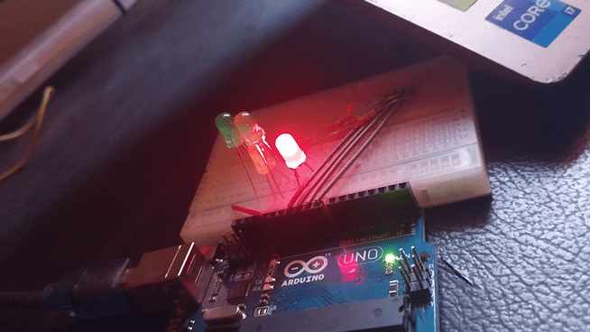

# Arduino LED Chasing Controller


## Overview

This project implements a simple LED chasing sequence using an Arduino board.

Four LEDs are connected to digital pins 8, 9, 10, and 11. Only one LED is ON at a time, and the active LED moves to the next one every 500 milliseconds.

After reaching the fourth LED, the sequence automatically returns to the first LED and repeats continuously.

The project focuses on practicing fundamental C++ and embedded programming concepts.

---
## Demo



---

## Hardware Requirements

- Arduino board
- 4 LEDs
- 4 resistors (220Ω–330Ω)
- Breadboard
- Jumper wires

## Circuit Connections

| LED | Arduino Pin |
|---|---|
| LED 1 | Digital Pin 8 |
| LED 2 | Digital Pin 9 |
| LED 3 | Digital Pin 10 |
| LED 4 | Digital Pin 11 |

Connect each LED's anode (long leg) to its Arduino pin through a current-limiting resistor, and connect its cathode (short leg) to GND.

## How It Works

The program uses an array to store the LED pin numbers:

```cpp
const int ledPins[] = {8, 9, 10, 11};
```

A `for` loop initializes all LED pins as outputs.

The variable `currentLed` stores the index of the currently active LED, starting at index 0.

The `millis()` function tracks elapsed time without stopping the program.

When 500 milliseconds have passed:

1. The current LED turns OFF.
2. The `currentLed` index moves to the next LED.
3. The next LED turns ON.
4. The timer is updated.

The modulo operator (`%`) ensures that the index returns to zero after reaching the last LED.


## Key Concepts Practiced

- Arrays and array indexing
- `sizeof()` for calculating array length
- `for` loops
- Non-blocking programming using `millis()`
- Time-based conditions
- Modulo operator (`%`)
- State tracking
- Digital output control

## What I Learned

This project helped me understand how to control a sequence of hardware outputs using a single index variable and non-blocking timing.

It also demonstrated how the modulo operator can be used to create repeating cycles without exceeding an array's valid index range.

## Future Improvements

- Add multiple chasing patterns.
- Control the sequence speed using a potentiometer.
- Introduce button-based pattern selection.
- Apply the same logic to more complex LED and robotics projects.
